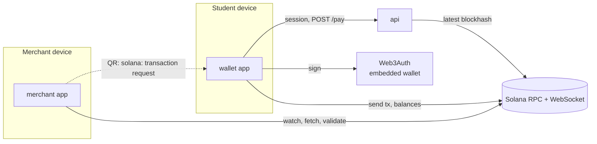
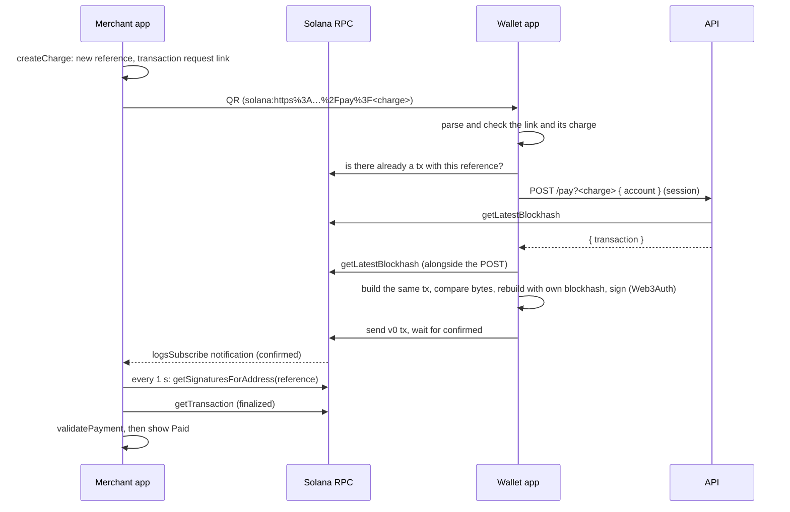

# Architecture

What the project is for: [overview.md](overview.md). This document covers how
it's built and why. Per-app details (setup, routes, measurements, known issues)
stay in each README; this links to them instead of repeating them.

## System context

Both apps are static single-page apps. `apps/api` (Elysia on Bun) authenticates
wallet users (see [API sessions](#api-sessions)) and builds the payment
transactions the wallet signs: the merchant's QR is a Solana Pay transaction
request to it. It has no database: the charge travels in the link, and the
chain is still the only state the apps share. It will sponsor the wallet's
transaction fees.



The QR code is the only channel between the apps: the merchant shows a Solana Pay
link, the wallet reads it. Neither app calls the other, and the merchant never
calls the API.

## Monorepo

The dependency graph comes from the workspace manifests. Ask Turborepo for it
instead of trusting a drawing:

```sh
aube exec turbo ls                    # every workspace and its path
aube exec turbo ls wallet             # what one workspace depends on, and its tasks
aube exec turbo run transit --graph   # the whole graph, as Graphviz DOT
```

| Workspace                    | Owns                                                                       |
| ---------------------------- | -------------------------------------------------------------------------- |
| `apps/wallet`                | Login, balances, scanning or pasting a link, paying, payment metrics.      |
| `apps/merchant`              | The charge form, the QR, detecting and validating the payment.             |
| `apps/api`                   | Sessions, and building the payment transaction of a charge.                |
| `tools/registry`             | Commands to register merchants on-chain (the merchant registry).           |
| `packages/payments`          | Token config, amounts, Solana Pay links, payment transactions, validation. |
| `packages/i18n`              | English and Spanish texts as one Paraglide project; each app compiles it.  |
| `packages/ui`                | shadcn/ui components on Base UI, Tailwind v4 tokens.                       |
| `packages/oxlint-config`     | Shared lint rules, including the app layer boundaries.                     |
| `packages/typescript-config` | Shared `tsconfig` bases.                                                   |

Packages have no build step: apps import their TypeScript source through
`exports` (`@repo/payments/<module>`, `@repo/ui/components/<name>`).

### Inside an app

`wallet` and `merchant` follow bulletproof-react, enforced by lint
(`@repo/oxlint-config/react-app`):

```text
src/app        routes, router, providers   (can import everything)
src/features   one folder per feature       (can't import other features or app)
src/{components,config,hooks,lib,stores,utils,types}   shared (can't import features)
```

Screens are composed in `src/app/routes`.

`api` has its own layers, also enforced by lint (`@repo/oxlint-config/api`):

```text
src/index.ts       starts the server (the only place for Bun APIs)
src/app.ts         composes the route features
src/routes/<name>  one folder per feature: index (routes), model (schemas), service (logic)
src/{config,lib,plugins}   shared (can't import routes or the app)
```

Services and `src/lib` don't import Elysia values: they return errors and the
route maps them to HTTP statuses.

## Payment flow



1. **Charge.** `createCharge` (`apps/merchant`) makes a new `reference` and
   encodes a Solana Pay transaction request: the `solana:` link in the QR is
   the API's payment endpoint (`VITE_PAYMENT_REQUEST_URL`), URL-encoded, with
   the charge (recipient, amount, token, reference, label, message) in its
   query. The merchant's own page URL
   (`/charges/<reference>?amount=…&concept=…`) holds only the reference, amount
   and concept, and the recipient, token and label always come from config, so
   editing that URL can't redirect the payment.
2. **Pay.** The wallet checks the link (`createPaymentLinkSchema`): a request
   to our endpoint, right token, a reference, not to oneself. On **Pay** it
   asks the API for the transaction (`POST /pay`, with the session; it never
   fetches the link's own URL). The API checks the charge the same way, reads
   the latest blockhash and builds it with `buildPaymentTransaction`: v0, the
   payer as fee payer, the recipient's token account created if needed
   (idempotent), then `TransferChecked` last, with the reference appended as a
   read-only account. The wallet builds the same transaction with the API's
   blockhash and goes on only if the bytes match. As Solana Pay asks of an
   unsigned transaction, it then sets the latest blockhash, which it read from
   its own RPC alongside the `POST`, signs, sends it and waits for
   `confirmed`. A payment is never retried automatically: only the payer
   decides, once they know how the last one ended.
3. **Detect.** `waitForPayment` listens to `logsSubscribe` for the reference
   (fast path) and, in parallel, asks the RPC every second for transactions that
   mention it. The second one is always on: it covers dropped notifications and
   finds payments that landed before the subscription was ready. A simulated
   transaction (all-zero signature) is ignored.
4. **Validate.** The transaction is fetched at `finalized` and checked by
   `validatePayment`: it succeeded, it includes the reference, and the
   recipient's token accounts received exactly the amount. Anything else is
   ignored and the charge keeps waiting.

## API sessions

The wallet proves who the user is to `apps/api` with the MetaMask Embedded
Wallets (Web3Auth) identity token, and gets a session of ours in exchange:

```mermaid
sequenceDiagram
  participant W as Wallet app
  participant A as API
  participant J as Web3Auth JWKS
  W->>W: web3Auth.getAuthTokenInfo() → idToken
  W->>A: POST /auth/session (Bearer idToken, { address })
  A->>J: signing keys (cached)
  A->>A: verify ES256, iss, aud = client ID, exp; address ∈ ed25519 wallets
  A-->>W: { token, expiresAt } (HS256, sub = address, 1 h)
  W->>A: later requests: Bearer token
```

- The identity token is ES256, issuer `web3auth.io`, keys at
  `https://api.web3auth.io/citadel-service/.well-known/jwks.json`. Web3Auth's
  docs (`api-auth.web3auth.io`) are outdated for the v11 SDK.
- Every Web3Auth project shares those keys: the audience (our client ID) is
  what makes a token ours.
- The token's `wallets` claim carries the user's ed25519 public keys, i.e. its
  Solana addresses, so the address the wallet claims is checked against it
  with no signature from the wallet.
- The wallet's address is the token's `web3auth_app_key` ed25519 entry (seen
  in a live login).
- The identity token lasts 24 hours from login and the SDK doesn't refresh
  it, hence our own session. Once it expires, the user has to log in again to
  get a new session. The wallet keeps it in memory. The API signs sessions
  with `API_SESSION_KEY` (Infisical), so they survive restarts and every
  instance accepts them; changing the key ends them all.

The wallet calls the API through `apiClient`, an Eden Treaty client typed from
the API's `App` type (a type-only import, so no server code reaches the
bundle). It sends the session as bearer and, on a 401, opens a new one and
retries once. A route change in the API shows up as a type error in the wallet.

Details: the [api](../apps/api/README.md#sessions) and
[wallet](../apps/wallet/README.md#api) READMEs.

## Design decisions

| Decision                                                                         | Why                                                                                                                                                                                    |
| -------------------------------------------------------------------------------- | -------------------------------------------------------------------------------------------------------------------------------------------------------------------------------------- |
| The `reference` correlates a charge with its payment.                            | It needs no database and no shared state: the chain is the lookup table.                                                                                                               |
| The QR is a transaction request; the API builds the transaction.                 | It's what lets the API sponsor the fee later: it has to build, check and sign the transaction it pays for. The charge travels in the link's query, so the API stores nothing.          |
| The wallet rebuilds the API's transaction and compares the bytes before signing. | Web3Auth signs without asking: this is the check that the API (or whoever answers in its place) only gets this payment signed. API and wallet must build payments the same way.        |
| The wallet only pays links to `VITE_PAYMENT_REQUEST_URL`, and calls its own API. | The session never goes to a host from a QR, and a charge always means the same thing. Solana Pay would `POST` to the link's URL: both come from `API_PUBLIC_URL`, so they're the same. |
| Announce at `confirmed`, validate at `finalized`.                                | Measured on devnet: both notify at the same time, `finalized` loses more notifications, and a transaction is fetchable at `finalized` right away. "Paid" then can't be reverted.       |
| Validate by token balance change, not by decoding the instruction.               | It works with any transaction shape, including a smart wallet's CPI, which prepares the move to a smart wallet. On-chain data is untrusted: everything is compared with the request.   |
| `PAYMENT_TOKEN` instead of `EURC` in the apps.                                   | Swapping to the campus Token-2022 token is a one-line change. The token's program is carried with it: never assume the classic Token program.                                          |
| The charge lives in the URL (merchant) and the payment link in the URL (wallet). | A reload shows the same charge or confirmation and keeps watching. Apps hold only what the URL can't.                                                                                  |
| No automatic payment retry.                                                      | A signed transaction may have landed: paying again could charge twice.                                                                                                                 |
| Sent payments and metrics stay on the device (`localStorage`, last 50).          | The API keeps nothing; the wallet also uses it to recognise payments it already sent.                                                                                                  |
| Env values are validated at build time (Varlock) and end up in the bundle.       | A bad config fails `dev` and `build`, not a payment. Nothing secret goes in `VITE_*`.                                                                                                  |

## Merchant registry

Being a merchant means having an attestation from the university on the
Solana Attestation Service (SAS): one per merchant, under the university's
credential and the `merchant` schema, with the merchant's name. Its address is
a PDA of the credential, the schema and the merchant's address, so anyone can
find it from the address alone. `tools/registry` writes them (`merchant:add`,
`merchant:remove`), signed by the credential's authority;
`@repo/payments/merchant-registry` reads them.

It's on-chain, not in the API's database, because the entries are few,
public, rarely changed and written by one authority: the wallet will check a
merchant against the chain itself, so a compromised API can't invent a
merchant or a name. Registering also creates the merchant's token account for
`PAYMENT_TOKEN`, so the sponsored fee payer never creates accounts.

Today nothing reads it yet: the merchant app still charges for the address in
its config, and the wallet shows the link's label. The API's merchant
sessions and the wallet's verified names come next.

The transactions that write it are built in `@repo/payments/merchant-registry`
(`planMerchantRegistration`, `planMerchantRemoval`), so a planned admin app
(#55) sends the same ones as the CLI, signed by each admin's own wallet: the
keys that sign registrations never live on a server.

Details: [`tools/registry`](../tools/registry/README.md).

## Trust model and limits

- **The payer's only check is the confirmation screen.** Web3Auth signs without
  asking, and the merchant name is whatever the link's author wrote, so the
  screen shows the full address. Verified merchants need the registry.
- **Validation runs in the merchant's browser.** Fine for a demo; before anything
  of value depends on it, a backend must verify too.
- **"Already paid" is best effort.** Anyone can mention a reference in a
  transaction, and two devices can pay at once.
- **The public devnet RPC drops notifications and limits per IP.** A real
  deployment needs a dedicated RPC.
- **Web3Auth only signs `legacy` and v0 transactions**, so payments can't use v1.
- **Only our wallet can pay a charge.** `POST /pay` needs our session, so a
  generic Solana Pay wallet can't. There's no `GET` (label, icon). The link
  must be HTTPS, except to `localhost` in dev.
- **Paying needs the API.** If it's down or its RPC fails, the payment fails
  before anything is signed, and paying again is safe.

Details and numbers: the _Known issues_ sections of the
[wallet](../apps/wallet/README.md#known-issues) and
[merchant](../apps/merchant/README.md#known-issues) READMEs.

## Planned changes and what they touch

- **Campus token (Token-2022).** Change `PAYMENT_TOKEN`. Token-2022 extensions
  need care in `@repo/payments`: with _default account state frozen_, the
  recipient's token account created in the first payment would be born frozen
  and the transfer would fail until the issuer thaws it, so merchants'
  accounts must be set up beforehand (ties into the merchant registry). A
  _permanent delegate_ means holders trust the issuer not to move their balance.
- **Non-custodial smart wallet.** Replaces Web3Auth. Find what it touches with
  `grep -rli web3auth apps/wallet/src`: the login, the providers, the signer
  and the payment client, plus the screens that read the account. v1
  transactions may become possible. `validatePayment` already copes with smart-wallet
  transaction shapes.
- **Sponsored network fees.** The goal is that users never see SOL or fees: the
  university pays them. What follows is deduced from the current code, not yet
  decided design:
  - The API must sign as fee payer. It already builds the transaction (`POST
    /pay`) and only for the session's account; what's left is setting the
    university's key as fee payer in `buildPaymentTransaction`, signing in the
    route, and rate-limiting, or anyone could drain the university's SOL. The
    wallet already checks the transaction byte for byte; it would then keep
    the API's blockhash and signature instead of setting its own blockhash,
    as Solana Pay asks of a signed transaction.
  - `buildPaymentInstructions` makes the payer pay the creation of the
    recipient's token account (~0.0015 SOL, first payment to a merchant). With
    sponsoring, that rent moves to the sponsor too.
  - The SOL balance (`use-sol-balance`), the "not enough SOL" failure and the
    SOL faucet step go away.
  - The confirmation screen shows the merchant's full address and Explorer
    links. The address is today the payer's only check, so it can go only once
    verified merchants exist (registry).
  - `validatePayment` is unaffected: it reads balance changes, not who paid.
- **Merchant logins and backend verification.** The registry exists (see
  [Merchant registry](#merchant-registry)). `config/merchant.ts` becomes the
  logged-in merchant, checked against the registry by the API; the wallet
  shows the attested name; a backend re-validates payments.
- **Mainnet.** A dedicated RPC and a priority-fee decision (none on devnet).
  If Web3Auth is still in use by then, its mainnet network too.

## Cross-cutting

- **Environment**: Varlock schemas per app, shared values in the root schema,
  development values from Infisical, `.env.test` for tests and CI.
- **i18n**: every text goes through Paraglide (`m.<key>()`), prefixed per app;
  amounts and dates through `#/lib/format`.
- **Design system**: semantic token classes only; tokens in
  `packages/ui/src/styles/globals.css`.
- **Tooling**: Turborepo tasks (`lint` depends on `codegen`), aube as package
  manager, Oxlint for lint and type-check, Oxfmt for formatting. Commands and
  CI: root [README](../README.md) and [AGENTS.md](../AGENTS.md).

## Where things live

| Concept                         | File                                                                         |
| ------------------------------- | ---------------------------------------------------------------------------- |
| Payment token                   | `packages/payments/src/config.ts`                                            |
| Solana Pay link build and parse | `packages/payments/src/solana-pay.ts`                                        |
| Payment transaction             | `packages/payments/src/transfer.ts`                                          |
| Building payments (server)      | `apps/api/src/routes/pay/`                                                   |
| Payment validation              | `packages/payments/src/validate-payment.ts`                                  |
| Charge creation                 | `apps/merchant/src/features/charge/utils/create-charge.ts`                   |
| Payment detection               | `apps/merchant/src/features/charge/utils/wait-for-payment.ts`                |
| Merchant identity               | `apps/merchant/src/config/merchant.ts`                                       |
| Merchant registry (read)        | `packages/payments/src/merchant-registry.ts`, `config.ts`                    |
| Merchant registry (write)       | `tools/registry/src/commands/`                                               |
| Link checks (wallet)            | `apps/wallet/src/features/pay/utils/payment-link.ts`                         |
| Sending a payment               | `apps/wallet/src/features/pay/utils/send-payment.ts`, `hooks/use-payment.ts` |
| Checking the API's transaction  | `apps/wallet/src/features/pay/utils/payment-transaction.ts`                  |
| Wallet and chain setup          | `apps/wallet/src/lib/web3auth.ts`, `solana-client.ts`                        |
| API sessions (server)           | `apps/api/src/routes/auth/`, `apps/api/src/plugins/session-auth.ts`          |
| API session (wallet)            | `apps/wallet/src/lib/api-session.ts`                                         |
| API client (wallet)             | `apps/wallet/src/lib/api-client.ts`                                          |
| Texts                           | `packages/i18n/messages/{en,es}.json`                                        |
