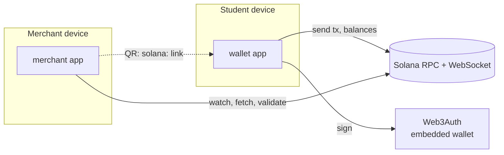
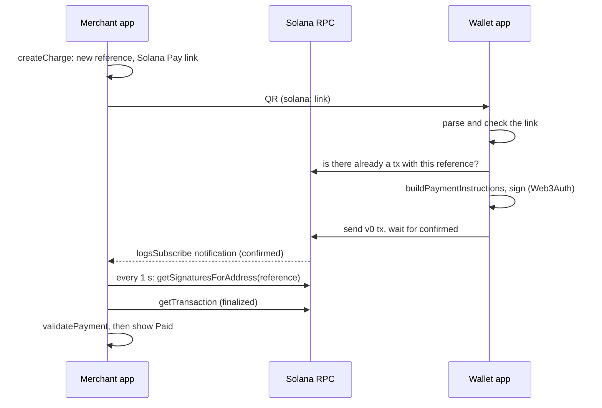

# Architecture

What the project is for: [overview.md](overview.md). This document covers how
it's built and why. Per-app details (setup, routes, measurements, known issues)
stay in each README; this links to them instead of repeating them.

## System context

Today there is no backend in the payment flow. Both apps are static single-page
apps that talk to Solana directly. The chain is the only state the two apps share. `apps/api` (Elysia on
Bun) is only a skeleton with a health check so far; it will sponsor the
wallet's transaction fees.



The QR code is the only channel between the apps: the merchant shows a Solana Pay
link, the wallet reads it. Neither app calls the other.

## Monorepo

The dependency graph comes from the workspace manifests. Ask Turborepo for it
instead of trusting a drawing:

```sh
aube exec turbo ls                    # every workspace and its path
aube exec turbo ls wallet             # what one workspace depends on, and its tasks
aube exec turbo run transit --graph   # the whole graph, as Graphviz DOT
```

| Workspace                    | Owns                                                                       |
| ---------------------------- | -------------------------------------------------------------------------- |
| `apps/wallet`                | Login, balances, scanning or pasting a link, paying, payment metrics.      |
| `apps/merchant`              | The charge form, the QR, detecting and validating the payment.             |
| `packages/payments`          | Token config, amounts, Solana Pay links, payment instructions, validation. |
| `packages/i18n`              | English and Spanish texts as one Paraglide project; each app compiles it.  |
| `packages/ui`                | shadcn/ui components on Base UI, Tailwind v4 tokens.                       |
| `packages/oxlint-config`     | Shared lint rules, including the app layer boundaries.                     |
| `packages/typescript-config` | Shared `tsconfig` bases.                                                   |

Packages have no build step: apps import their TypeScript source through
`exports` (`@repo/payments/<module>`, `@repo/ui/components/<name>`).

### Inside an app

`wallet` and `merchant` follow bulletproof-react, enforced by lint
(`@repo/oxlint-config/react-app`):

```text
src/app        routes, router, providers   (can import everything)
src/features   one folder per feature       (can't import other features or app)
src/{components,config,hooks,lib,stores,utils,types}   shared (can't import features)
```

Screens are composed in `src/app/routes`.

## Payment flow



1. **Charge.** `createCharge` (`apps/merchant`) makes a new `reference` and
   encodes a Solana Pay transfer request: the `solana:` link in the QR, which
   carries the recipient. The merchant's own page URL
   (`/charges/<reference>?amount=…&concept=…`) holds only the reference, amount
   and concept, and the recipient, token and label always come from config, so
   editing that URL can't redirect the payment.
2. **Pay.** The wallet checks the link (`createPaymentLinkSchema`): right
   token, a reference, no memo, not to oneself. `buildPaymentInstructions`
   creates the recipient's token account if needed (idempotent), then
   `TransferChecked` last, with the reference appended as a read-only account.
   It is sent as a v0 transaction and awaited at `confirmed`. A payment is
   never retried automatically: only the payer decides, once they know how the
   last one ended.
3. **Detect.** `waitForPayment` listens to `logsSubscribe` for the reference
   (fast path) and, in parallel, asks the RPC every second for transactions that
   mention it. The second one is always on: it covers dropped notifications and
   finds payments that landed before the subscription was ready. A simulated
   transaction (all-zero signature) is ignored.
4. **Validate.** The transaction is fetched at `finalized` and checked by
   `validatePayment`: it succeeded, it includes the reference, and the
   recipient's token accounts received exactly the amount. Anything else is
   ignored and the charge keeps waiting.

## Design decisions

| Decision                                                                         | Why                                                                                                                                                                                  |
| -------------------------------------------------------------------------------- | ------------------------------------------------------------------------------------------------------------------------------------------------------------------------------------ |
| The `reference` correlates a charge with its payment.                            | It needs no backend and no shared state: the chain is the lookup table.                                                                                                              |
| Announce at `confirmed`, validate at `finalized`.                                | Measured on devnet: both notify at the same time, `finalized` loses more notifications, and a transaction is fetchable at `finalized` right away. "Paid" then can't be reverted.     |
| Validate by token balance change, not by decoding the instruction.               | It works with any transaction shape, including a smart wallet's CPI, which prepares the move to a smart wallet. On-chain data is untrusted: everything is compared with the request. |
| `PAYMENT_TOKEN` instead of `EURC` in the apps.                                   | Swapping to the campus Token-2022 token is a one-line change. The token's program is carried with it: never assume the classic Token program.                                        |
| The charge lives in the URL (merchant) and the payment link in the URL (wallet). | A reload shows the same charge or confirmation and keeps watching. Apps hold only what the URL can't.                                                                                |
| No automatic payment retry.                                                      | A signed transaction may have landed: paying again could charge twice.                                                                                                               |
| Sent payments and metrics stay on the device (`localStorage`, last 50).          | There's no backend; the wallet also uses it to recognise payments it already sent.                                                                                                   |
| Env values are validated at build time (Varlock) and end up in the bundle.       | A bad config fails `dev` and `build`, not a payment. Nothing secret goes in `VITE_*`.                                                                                                |

## Trust model and limits

- **The payer's only check is the confirmation screen.** Web3Auth signs without
  asking, and the merchant name is whatever the link's author wrote, so the
  screen shows the full address. Verified merchants need the registry.
- **Validation runs in the merchant's browser.** Fine for a demo; before anything
  of value depends on it, a backend must verify too.
- **"Already paid" is best effort.** Anyone can mention a reference in a
  transaction, and two devices can pay at once.
- **The public devnet RPC drops notifications and limits per IP.** A real
  deployment needs a dedicated RPC.
- **Web3Auth only signs `legacy` and v0 transactions**, so payments can't use v1.

Details and numbers: the _Known issues_ sections of the
[wallet](../apps/wallet/README.md#known-issues) and
[merchant](../apps/merchant/README.md#known-issues) READMEs.

## Planned changes and what they touch

- **Campus token (Token-2022).** Change `PAYMENT_TOKEN`. Token-2022 extensions
  need care in `@repo/payments`: with _default account state frozen_, the
  recipient's token account created in the first payment would be born frozen
  and the transfer would fail until the issuer thaws it, so merchants'
  accounts must be set up beforehand (ties into the merchant registry). A
  _permanent delegate_ means holders trust the issuer not to move their balance.
- **Non-custodial smart wallet.** Replaces Web3Auth. Find what it touches with
  `grep -rli web3auth apps/wallet/src`: the login, the providers, the signer
  and the payment client, plus the screens that read the account. v1
  transactions may become possible. `validatePayment` already copes with smart-wallet
  transaction shapes.
- **Sponsored network fees.** The goal is that users never see SOL or fees: the
  university pays them. What follows is deduced from the current code, not yet
  decided design:
  - A service must sign as fee payer. The university's key can't live in the
    browser, which is one more reason for the planned backend. It has to check
    what it signs (only campus-token payments) and rate-limit, or anyone could
    drain the university's SOL.
  - `buildPaymentInstructions` makes the payer pay the creation of the
    recipient's token account (~0.0015 SOL, first payment to a merchant). With
    sponsoring, that rent moves to the sponsor too.
  - The SOL balance (`use-sol-balance`), the "not enough SOL" failure and the
    SOL faucet step go away.
  - The confirmation screen shows the merchant's full address and Explorer
    links. The address is today the payer's only check, so it can go only once
    verified merchants exist (registry).
  - `validatePayment` is unaffected: it reads balance changes, not who paid.
- **Merchant registry, logins and backend verification.** `config/merchant.ts`
  becomes a registry lookup; the merchant name becomes verified; a backend
  re-validates payments.
- **Mainnet.** A dedicated RPC and a priority-fee decision (none on devnet).
  If Web3Auth is still in use by then, its mainnet network too.

## Cross-cutting

- **Environment**: Varlock schemas per app, shared values in the root schema,
  development values from Infisical, `.env.test` for tests and CI.
- **i18n**: every text goes through Paraglide (`m.<key>()`), prefixed per app;
  amounts and dates through `#/lib/format`.
- **Design system**: semantic token classes only; tokens in
  `packages/ui/src/styles/globals.css`.
- **Tooling**: Turborepo tasks (`lint` depends on `codegen`), aube as package
  manager, Oxlint for lint and type-check, Oxfmt for formatting. Commands and
  CI: root [README](../README.md) and [AGENTS.md](../AGENTS.md).

## Where things live

| Concept                         | File                                                                       |
| ------------------------------- | -------------------------------------------------------------------------- |
| Payment token                   | `packages/payments/src/config.ts`                                          |
| Solana Pay link build and parse | `packages/payments/src/solana-pay.ts`                                      |
| Payment instructions            | `packages/payments/src/transfer.ts`                                        |
| Payment validation              | `packages/payments/src/validate-payment.ts`                                |
| Charge creation                 | `apps/merchant/src/features/charge/utils/create-charge.ts`                 |
| Payment detection               | `apps/merchant/src/features/charge/utils/wait-for-payment.ts`              |
| Merchant identity               | `apps/merchant/src/config/merchant.ts`                                     |
| Link checks (wallet)            | `apps/wallet/src/features/pay/utils/payment-link.ts`                       |
| Sending a payment               | `apps/wallet/src/features/pay/hooks/use-payment.ts`                        |
| Wallet and chain setup          | `apps/wallet/src/lib/web3auth.ts`, `payment-client.ts`, `solana-client.ts` |
| Texts                           | `packages/i18n/messages/{en,es}.json`                                      |
